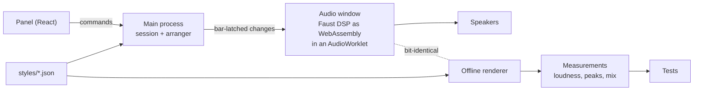
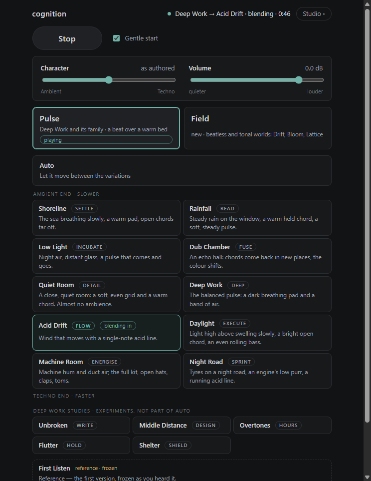
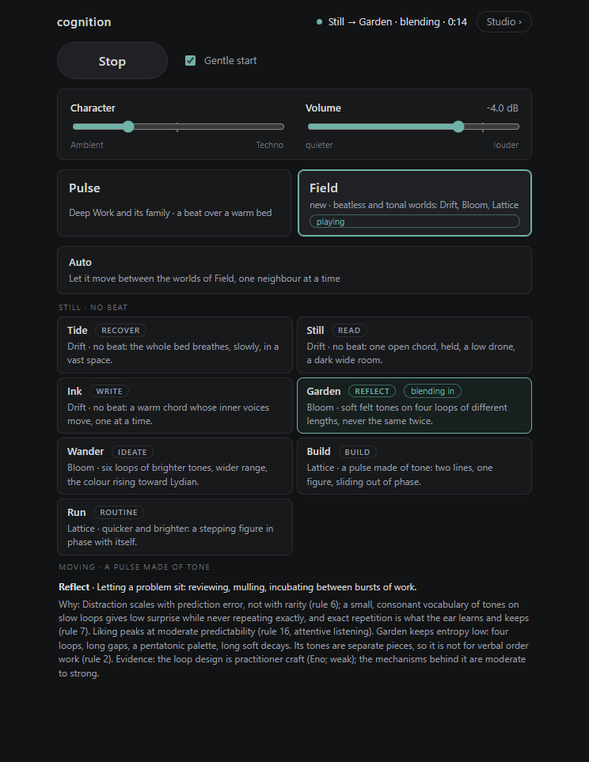
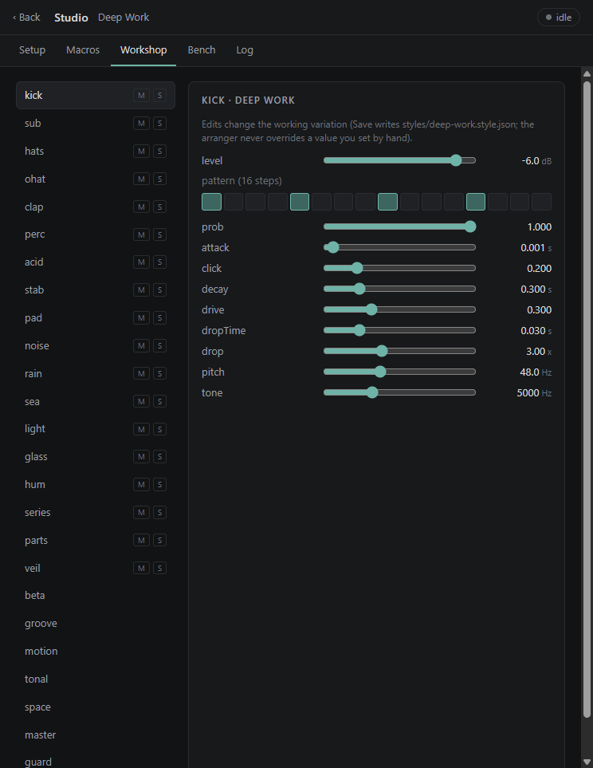

# Cognition

A desktop app that plays generative music for focused work. Each of its sound worlds is built for a different kind of thinking, like reading, deep focus, short sprints or letting a problem sit, and the choices behind each one come from research on sound and attention.

**Built:** October 2026 | **Runs as:** an Electron desktop app on Windows

https://github.com/user-attachments/assets/97c01001-6a5d-48a5-a7dd-c91f9aa8e899

*Four 20-second excerpts, rendered offline. It's the same audio the app plays, raised in level for listening.*

## The idea

Most focus music is a playlist. I wanted sound that knows what job it's doing. Cognition has ten variations on one minimal techno family and seven beatless worlds called Field, and each one is tuned for a cognitive job: Read, Deep, Sprint, Reflect and so on. A variation builds up from nothing, one element at a time, breathes out every so often, and can move to a neighbour on its own. Five Deep Work studies each test one finding, like covering the frequency band speech is understood in when voices are nearby.

The second idea is how it was made. Claude can't hear, so the loop runs on measurement. I listen and say what works. Claude renders the variations offline, measures them (loudness, peaks, how each layer sits in the mix), finds what separates the ones I kept from the ones I didn't, and writes each verdict down as a test so it can't drift. The offline render is bit-identical to what the app plays, so every number is a fact about the sound I hear. The full write-up is in [`plan/how-the-ai-works.md`](plan/how-the-ai-works.md).

## How it works

- **Sound engine.** The DSP is written in Faust (`dsp/`), compiled to WebAssembly and run in an AudioWorklet inside a hidden Electron window.
- **Arranger.** `src/shared/conductor/` decides what plays: the build-up, sections, slow tides, blends between variations, and Auto, which moves to a neighbour every 10 to 18 minutes. Every change lands on a bar line through a commit queue.
- **Styles.** Each variation is a JSON file in `styles/` holding its job, its parameters and its build order. They're validated with zod and hot-reload while the app runs.
- **Panel.** A React main screen, plus a Studio with a Workshop for every instrument, macros, an A/B bench and a log.
- **Checks.** 290 tests cover the parameter contract, the styles, the arranger and the rendered audio itself. A silent self-test drives the real app and confirms the live audio is bit-identical to the offline render.



## Status

Working on my machine as of 30 October 2026: the ten variations, the five Deep Work studies, the seven Field worlds, Auto and the Studio. The typecheck is clean, the self-test passes, and all 290 tests pass, though the ones that render audio take about 15 minutes. It's a personal tool, tuned for my own listening, and I've only run it on Windows.

## How I built it

I built it with Claude Code in October 2026, and the phases are in [`plan/progress.md`](plan/progress.md). I'm the ear. I decide what each variation is for and judge every version by listening, and my verdicts become tests. I don't hand-write the code.

The starting reference was the character of Endel's *Deeper Focus* with Plastikman: minimal techno, a steady pulse, slow filter sweeps. All sound and code here are original. The research behind each choice, with sources and how strong the evidence is, is in [`research/`](research/) and [`plan/current-state.md`](plan/current-state.md).

## Screenshots







## Run it

You need Windows, Node.js 22 or newer and npm.

```bash
npm install
npm run build
npm start
```

The panel opens, and closing it keeps the app in the tray. On first run it picks a Realtek output if there is one, otherwise your default device. You can change that in Studio, under Setup. `npm test`, `npm run typecheck` and `npm run selftest` run the checks.

This repository is a snapshot of the code as of 2026-10-30. The working repository is private.
